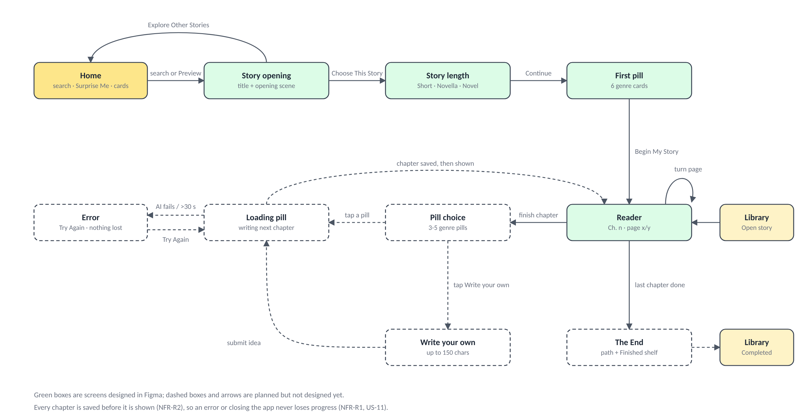
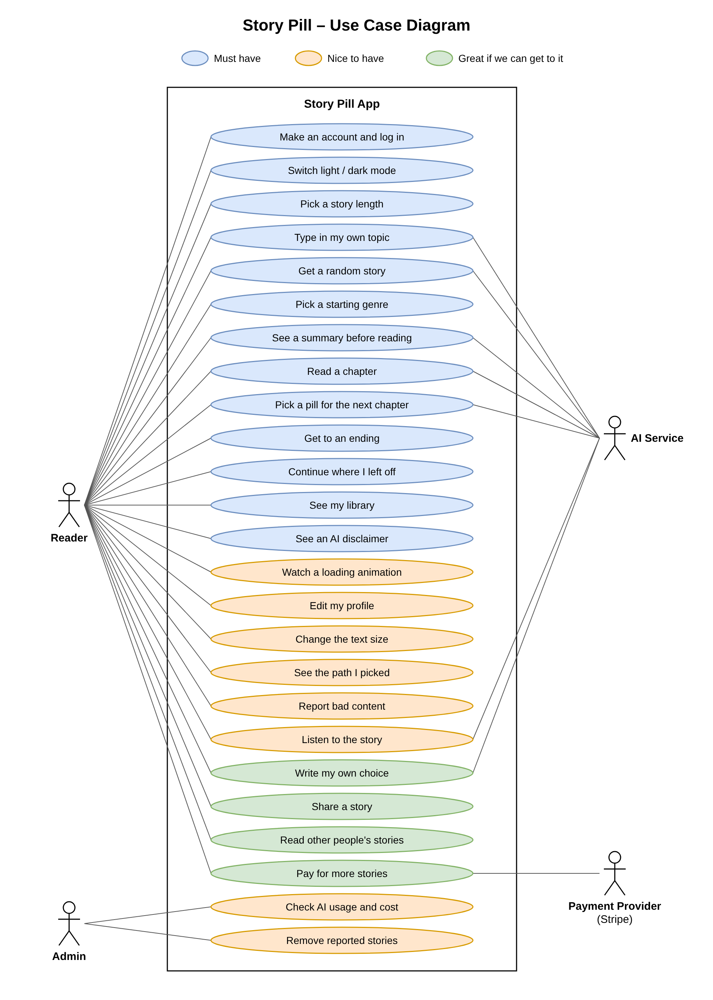
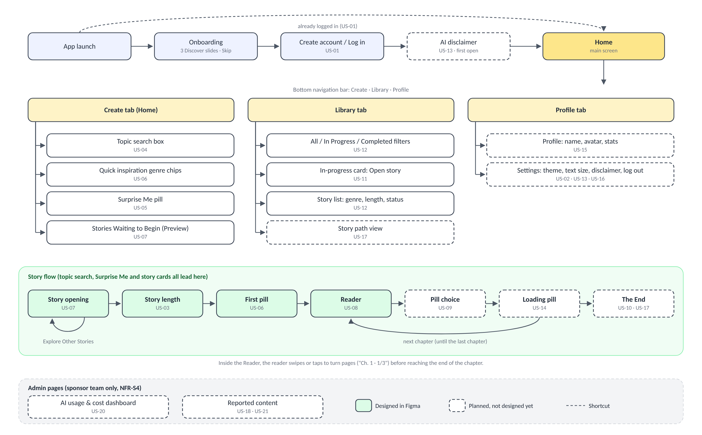
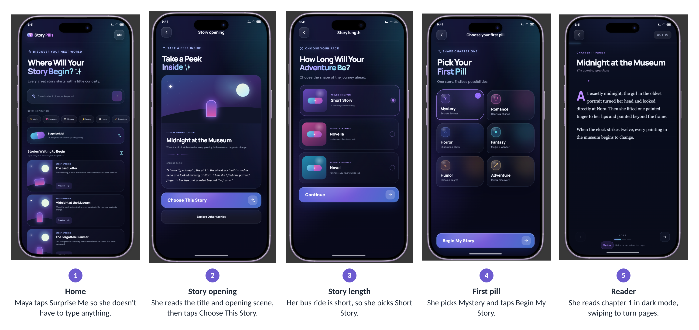

# 💊 Story Pill

**Choose-your-own-genre stories, written by AI, one chapter at a time.**

Story Pill is a cross-platform mobile app (iOS and Android) where readers get a story written for them by AI. At the end of every chapter, the reader taps a colorful genre "pill" such as Mystery, Romance or Horror, and the next chapter takes the story in that direction while keeping the same characters and setting. Every story has a real ending.

> SWE 117 course project · Team 8 · Built with our sponsor, who has approved the Figma prototype.

---

## Table of contents

- [How it works](#how-it-works)
- [Features](#features)
- [Who it's for](#who-its-for)
- [Design](#design)
- [Tech stack](#tech-stack)
- [Quality goals](#quality-goals)
- [Project status](#project-status)
- [Open questions](#open-questions)
- [Contributing](#contributing)

## How it works

1. **Start a story.** Type a topic ("a lighthouse keeper in 1920s Maine"), tap **Surprise Me** for a random one, or preview a story card on Home.
2. **Peek inside.** See the title, a short summary and the opening scene, then choose the story or explore others.
3. **Pick a length.** Short Story (about 3 chapters), Novella (about 4) or Novel (about 8).
4. **Pick your first pill.** Mystery, Romance, Horror, Fantasy, Humor or Adventure.
5. **Read, pick, repeat.** After each chapter, pick a new pill. A pill animation plays while the AI writes the next chapter.
6. **Reach The End.** The last chapter wraps the story up, shows the path of pills you picked, and moves the story to your Library.

## Features

We track 25 user stories (US-01 to US-25) in three priority levels.

### Must have

| ID | Feature |
| --- | --- |
| US-01 | Create an account and log in (email and password, synced across devices) |
| US-02 | Light, Dark or System theme |
| US-03 | Pick a story length |
| US-04 | Type your own topic (1 to 200 characters, with content filtering) |
| US-05 | Get a random story |
| US-06 | Pick a starting genre pill |
| US-07 | See a title and summary before reading |
| US-08 | Read chapters on a clean, book-like screen |
| US-09 | Pick a genre pill for the next chapter |
| US-10 | Every story reaches an ending |
| US-11 | Continue where you left off |
| US-12 | Library of In Progress and Finished stories |
| US-13 | AI-generated content disclaimer |

### Nice to have

| ID | Feature |
| --- | --- |
| US-14 | Pill loading animation (with Keep Waiting / Try Again after 30s) |
| US-15 | Profile with display name, avatar and reading stats |
| US-16 | Adjustable text size |
| US-17 | See the path of pills you picked |
| US-18 | Report a chapter |
| US-19 | Listen to the story (text to speech, lock-screen controls) |
| US-20 | Admin dashboard for AI usage and cost |
| US-21 | Admin review of reported content |

### Great if we can get to it

| ID | Feature |
| --- | --- |
| US-22 | "Write your own" pill (up to 150 characters) |
| US-23 | Share a finished story by link |
| US-24 | Community page of shared stories |
| US-25 | Paid subscription for more stories |

## Who it's for

Our main users are readers aged 18 to 35. We designed around four personas:

- **Maya, the Commuter (22).** Reads short stories on a 25-minute bus ride, in dark mode, with no setup.
- **Jordan, the Genre Hopper (29).** Likes longer stories, full plot control, and mixing genres to see what happens.
- **Leo, the Listener (34).** A nurse on rotating shifts who prefers audio and uses large text.
- **Ava, the Storyteller (19).** A film student who wants to put her own ideas into the story and share the result.

## Design

The UI is designed in Figma Make and approved by our sponsor. Design principles:

- **Reading comes first.** The reader screen shows only the title, chapter, page and text.
- **Fast start.** Home to chapter 1 in four taps, with no typing needed via Surprise Me.
- **Pills are the main control.** Every genre has an icon, color, name and tagline, so color is never the only clue.
- **One main action per screen,** with a back button in the top left.
- **One design for both platforms.**

Visual style: a dark night-sky theme with purple and blue accents, gradient headings, a serif story font with drop caps, and a floating bottom bar with **Create**, **Library** and **Profile**.

Site map

Storyboard: Maya starts a story on the bus

## Tech stack

| Area | Choice |
| --- | --- |
| App | One cross-platform codebase for iOS and Android |
| Backend, database and auth | [Supabase](https://supabase.com) |
| Story generation | Large language model API. We're evaluating the Claude API alongside OpenAI, Gemini and lower-cost models |
| Design | Figma Make |
| Payments (stretch) | Stripe or app store billing |

Key architecture rules:

- The AI API key lives only on our server, never in the app (NFR-S1).
- The AI provider sits behind one module, so switching providers changes only that part of the code (NFR-M2).
- Chapter counts, genres and limits are remote config, so they can change without an app release (NFR-M3).
- Every chapter is saved to the database before the reader sees it (NFR-R2).

## Quality goals

| Area | Target |
| --- | --- |
| Performance | Summary in under 10s, next chapter in under 20s, app opens in under 3s, saved stories open in under 1s |
| Reliability | No lost chapters or choices if the AI fails; crash rate under 1% of sessions |
| Security | Users can only access their own stories; admin pages are admin-only; accounts can be fully deleted |
| Content safety | Inappropriate topics are blocked; characters stay consistent; chapters match the chosen genre |
| Cost | A short story costs under about $0.10 in AI fees, within a starting $200 budget; usage is logged per request |
| Usability | A new user starts reading within 1 minute without help; readable contrast in both themes |

## Project status

| Deliverable | Status |
| --- | --- |
| Section 1: Requirements (personas, use cases, 25 user stories, NFRs) | ✅ Done |
| Section 2: UI design (site map, screen flow, mockups, storyboards) | ✅ Done |
| Remaining screens (pill choice, loading, error, The End, profile, light mode, admin) | 🎨 In design |
| Implementation | 🚧 Not started |

## Open questions

- Final AI provider (Claude, OpenAI, Gemini, or a cheaper model)
- Final genre list, pill colors and how many pills to show
- Exact chapter counts per story length
- AI disclaimer and refund policy wording
- Whether the app can be used without an account (currently assumed no)

## Running the iOS app

The SwiftUI app is in `StoryPills/`. Open `StoryPills.xcodeproj` in Xcode 16+, pick an iPhone simulator and press Cmd+R. See [docs/ios-app.md](docs/ios-app.md) for the project layout and next steps.

## Contributing

All code lives in this repo, and every change is reviewed by a teammate before merging (NFR-M4).

1. Create a branch from `main`.
2. Open a pull request that references the user story it implements (for example `US-09`).
3. Get at least one teammate's approval before merging.

---

*Stories in Story Pill are generated by AI and may contain mistakes.*
